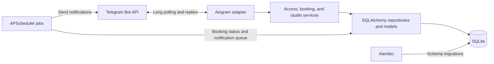

# Flat Booking

[Русская версия](README.ru.md)

[](LICENSE)
[](pyproject.toml)

Flat Booking is a self-hosted Telegram bot for scheduling a shared music or rehearsal studio. Members can find available times and manage their reservations from Telegram. Studio administrators manage access, booking policies, and announcements in the same bot. The bot interface is in Russian.

- Members can browse the calendar and daily schedule, book available time, and reschedule or cancel their reservations.
- Guests can request access. Administrators can review requests, manage the allowlist, and block or unblock members.
- Administrators can manage bookings, reserve time for maintenance, set studio rules and opening hours, send announcements, and review the audit log.
- The bot can send reminders 24 hours and 1 hour before a booking and post schedule changes to an optional studio group.

## Architecture

The Aiogram 3 adapter handles Telegram updates, navigation, and user-facing messages. Services enforce access and booking rules. Repositories and models persist data in SQLite through asynchronous SQLAlchemy 2 and aiosqlite. Alembic migrates the schema, APScheduler runs the booking status and notification jobs, and Pydantic Settings loads configuration. The bot uses long polling and needs outbound access to Telegram. No inbound web port is required.



Bookings are stored in UTC and displayed in the studio's time zone. A booking can span midnight. SQLite write transactions serialize overlap checks and reservation changes.

## Configure your studio

1. Create a bot with BotFather to obtain its token. [Telegram bot setup](https://core.telegram.org/bots/tutorial#obtain-your-bot-token)
2. From the repository root, create `.env` if it does not already exist.

   ```bash
   test -e .env || install -m 600 .env.example .env
   ```

3. Set `BOT_TOKEN`, `ADMIN_IDS`, and your studio settings. If you need your Telegram User ID, start the bot with an empty `ADMIN_IDS`, send `/id` in a private chat, then add the ID and restart.
4. Send `/start` from an administrator account and open **Управление студией** (Studio management).

| Variable | Purpose |
| --- | --- |
| `BOT_TOKEN` | BotFather token, required to run the bot. |
| `ADMIN_IDS` | Comma-separated Telegram User IDs for administrators. Restart after changing the list. |
| `WHITELIST_IDS` | Optional comma-separated member IDs. Imported once per database, even when the list is empty. Manage later changes through the bot. |
| `STUDIO_NAME`, `TIMEZONE`, `RULES` | Studio name, IANA time zone, and rules used to initialize a database. Set the time zone before the first startup with that database. |
| `ADMIN_CONTACT` | Optional contact shown to studio users. |
| `OPEN_MINUTE`, `CLOSE_MINUTE` | Daily opening and closing times in minutes after midnight. Use `0` and `1440` for 24-hour operation. A closing time before opening means the studio closes the following day. |
| `MAX_BOOKING_DAYS` | Number of calendar days ahead that users can book, in addition to today. |
| `MIN_BOOKING_MINUTES`, `MAX_BOOKING_MINUTES`, `BOOKING_STEP_MINUTES` | Allowed duration range and time increment. The maximum is 1440 minutes, and both bounds must be multiples of the increment. |
| `REMINDER_24H_ENABLED`, `REMINDER_1H_ENABLED` | Enable private booking reminders. Both default to `true`. |
| `STUDIO_CHAT_ID`, `GROUP_NOTIFICATIONS_ENABLED` | Optional negative group chat ID and switch for group notifications. Leave group notifications disabled unless you need them. |
| `DATABASE_URL` | File-backed SQLite URL. The default is `sqlite+aiosqlite:///data/flat.db`. With Compose, keep the file in the mounted `/app/data` directory. |
| `LOG_LEVEL`, `SQL_ECHO` | Application log level and SQL diagnostics. SQL parameter values are hidden. |
| `NOTIFICATION_POLL_INTERVAL_SECONDS`, `BOOKING_STATUS_CHECK_INTERVAL_SECONDS` | Notification and booking status check intervals. The defaults are 30 and 60 seconds. |

Studio settings are saved in SQLite on first startup. Use the admin menu to edit the studio name, rules, booking limits, opening hours, and notification options for an existing database. Editing their environment variables will only change the initial values used for a new database.

To enable group notifications, add the bot to your group with permission to post. An administrator can send `/chatid@your_bot_username` in the group to get the chat ID. Enter it in the studio settings and enable group notifications. The bot shares the member's name, booking time, and purpose in the group.

## Run locally

Install Python 3.12 or later and [uv](https://docs.astral.sh/uv/getting-started/installation/). Install your system's time-zone data if it is missing. After completing configuration, run the following from the repository root.

```bash
uv sync --locked --no-dev
uv run --no-sync alembic upgrade head
uv run --no-sync python -m app.main
```

## Deploy with Docker Compose

Install Docker Engine with the Compose plugin. After completing configuration, run:

```bash
docker compose config -q
docker compose up -d --build
docker compose logs -f bot
```

The image uses Python 3.13 and runs as an unprivileged user. The container applies migrations before starting the bot and keeps the SQLite database and its sidecar files in the `studio_data` volume. Run one polling instance per token. Use `docker compose stop bot` to stop it and keep the volume when updating or replacing the container.

## Back up and restore

Create snapshots with the SQLite backup script. Use a new filename for each snapshot and keep a protected copy outside the deployment. For a local installation:

```bash
uv run --no-sync python -m scripts.backup backups/studio-snapshot.sqlite
```

For Compose, write the snapshot in the volume, then copy it out:

```bash
docker compose exec -T bot python -m scripts.backup /app/data/backups/studio-snapshot.sqlite
docker compose cp bot:/app/data/backups/studio-snapshot.sqlite ./studio-snapshot.sqlite
```

To restore, stop the bot and take a separate snapshot of the current database first. Run `uv run --no-sync python -m scripts.restore backups/studio-snapshot.sqlite --yes` for a local installation and apply migrations before restarting. With Compose, place the snapshot where the container user can read it and run the following:

```bash
docker compose stop bot
docker compose run --rm --no-deps bot python -m scripts.restore /app/data/backups/studio-snapshot.sqlite --yes
docker compose up -d
```

A restored snapshot includes the allowlist and notification delivery state as of the backup. Keep database files, snapshots, and `.env` out of Git.

Before updating an installation, take a snapshot and stop the bot. With Compose, rebuild and restart while keeping the existing data volume. For a local installation, sync locked dependencies and run `alembic upgrade head` through uv before restarting. The migration from `ccf47a25f067` to `4c8e2e115f39` adds existing active members to the allowlist and raises a saved 240-minute booking limit to 1440 minutes. Review the limit in the admin menu after upgrading from that older schema.

## Develop and test

```bash
uv sync --locked
uv run --no-sync ruff check .
uv run --no-sync ruff format --check .
uv run --no-sync pytest
```

Tests use temporary SQLite files and substitute Telegram API calls, so they need no real bot token. To verify the Alembic schema independently, point it to a fresh temporary database:

```bash
(
  migration_dir="$(mktemp -d)"
  export DATABASE_URL="sqlite+aiosqlite:///${migration_dir}/flat-booking.sqlite"
  uv run --no-sync alembic upgrade head
  uv run --no-sync alembic check
)
```

The [GitHub Actions workflow](.github/workflows/ci.yml) checks Python 3.12 and 3.13 and builds the Docker image on pushes and pull requests.

See [Contributing](CONTRIBUTING.md), [Security](SECURITY.md), and the [Changelog](CHANGELOG.md). Flat Booking is distributed under the [MIT License](LICENSE).
