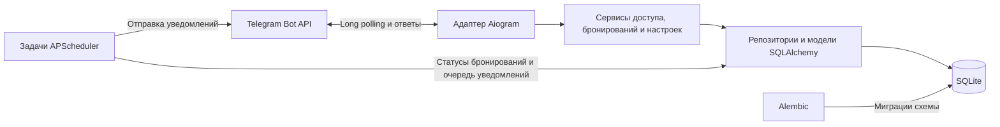

# Flat Booking

[English version](README.md)

[](LICENSE)
[](pyproject.toml)

Flat Booking — Telegram-бот для самостоятельного бронирования музыкальной или репетиционной студии. Участники выбирают время и управляют бронированиями в Telegram. Администраторы в том же боте управляют доступом, настройками и рассылками. Интерфейс бота на русском языке.

- Участники могут просматривать календарь и расписание на день, бронировать свободное время, переносить и отменять свои бронирования.
- Гости могут подать заявку на доступ. Администраторы рассматривают заявки, ведут белый список и могут блокировать доступ участников.
- Администраторы управляют бронированиями, выделяют время на обслуживание, задают правила и часы работы, отправляют объявления и просматривают журнал действий.
- Бот может отправлять напоминания за сутки и за час до бронирования и публиковать изменения расписания в общем чате студии.

## Архитектура

Адаптер на Aiogram 3 обрабатывает обновления Telegram, навигацию и сообщения. Сервисы проверяют права доступа и правила бронирования. Репозитории и модели хранят данные в SQLite через асинхронный SQLAlchemy 2 и aiosqlite. Alembic выполняет миграции, APScheduler запускает задачи проверки бронирований и доставки уведомлений, а Pydantic Settings загружает конфигурацию. Бот получает обновления через long polling. Для работы достаточно исходящего доступа к Telegram.



Бронирования хранятся в UTC и отображаются в часовом поясе студии. Интервалы могут пересекать полночь. SQLite сериализует проверку пересечений и изменение бронирований в транзакциях записи.

## Настройка студии

1. Создайте бота через BotFather, чтобы получить токен. [Инструкция Telegram по получению токена](https://core.telegram.org/bots/tutorial#obtain-your-bot-token)
2. Если файла `.env` ещё нет, создайте его из примера в каталоге проекта.

   ```bash
   test -e .env || install -m 600 .env.example .env
   ```

3. Укажите `BOT_TOKEN`, `ADMIN_IDS` и параметры студии. Если свой Telegram User ID неизвестен, запустите бота с пустым `ADMIN_IDS`, отправьте `/id` в личном чате, впишите полученный ID и перезапустите бота.
4. Отправьте `/start` с аккаунта администратора и откройте «Управление студией».

| Переменная | Назначение |
| --- | --- |
| `BOT_TOKEN` | Токен BotFather. Требуется для запуска бота. |
| `ADMIN_IDS` | Telegram User ID администраторов через запятую. После изменений перезапустите бота. |
| `WHITELIST_IDS` | Начальный список Telegram User ID участников через запятую. Считывается один раз на базу, даже если список пуст. Дальше список ведут через меню бота. |
| `STUDIO_NAME`, `TIMEZONE`, `RULES` | Название студии, часовой пояс IANA и правила для новой базы. Задайте часовой пояс перед первым запуском с этой базой. |
| `ADMIN_CONTACT` | Необязательный контакт, который видят пользователи студии. |
| `OPEN_MINUTE`, `CLOSE_MINUTE` | Часы работы в минутах от полуночи. Для круглосуточной работы задайте `0` и `1440`. Если закрытие раньше открытия, студия закрывается на следующий день. |
| `MAX_BOOKING_DAYS` | Число дней вперёд, доступных для бронирования, помимо текущего дня. |
| `MIN_BOOKING_MINUTES`, `MAX_BOOKING_MINUTES`, `BOOKING_STEP_MINUTES` | Границы длительности и шаг. Максимум составляет 1440 минут. Обе границы должны быть кратны шагу. |
| `REMINDER_24H_ENABLED`, `REMINDER_1H_ENABLED` | Напоминания в личном чате за сутки и за час. По умолчанию включены. |
| `STUDIO_CHAT_ID`, `GROUP_NOTIFICATIONS_ENABLED` | Необязательный отрицательный ID чата и переключатель групповых уведомлений. |
| `DATABASE_URL` | URL файловой SQLite-базы. По умолчанию `sqlite+aiosqlite:///data/flat.db`. В Compose храните базу в смонтированном каталоге `/app/data`. |
| `LOG_LEVEL`, `SQL_ECHO` | Уровень журналирования и вывод SQL для отладки. Значения параметров SQL скрыты. |
| `NOTIFICATION_POLL_INTERVAL_SECONDS`, `BOOKING_STATUS_CHECK_INTERVAL_SECONDS` | Интервалы проверки очереди уведомлений и статусов бронирований. По умолчанию 30 и 60 секунд. |

При первом запуске настройки студии сохраняются в SQLite. Для существующей базы меняйте название, правила, ограничения, часы работы и уведомления через меню администратора. Изменение соответствующих переменных окружения задаёт начальные значения только для новой базы.

Для групповых уведомлений добавьте бота в чат с правом отправлять сообщения. Администратор может узнать ID чата командой `/chatid@your_bot_username`. Укажите этот ID в настройках студии и включите уведомления. Бот публикует в группе имя участника, время и цель бронирования.

## Локальный запуск

Установите Python 3.12 или новее и [uv](https://docs.astral.sh/uv/getting-started/installation/). Установите системный пакет с данными часовых поясов, если он отсутствует. После заполнения `.env` выполните из каталога проекта:

```bash
uv sync --locked --no-dev
uv run --no-sync alembic upgrade head
uv run --no-sync python -m app.main
```

## Развёртывание через Docker Compose

Установите Docker Engine с плагином Compose. После настройки `.env` выполните:

```bash
docker compose config -q
docker compose up -d --build
docker compose logs -f bot
```

Образ использует Python 3.13 и запускается от непривилегированного пользователя. Контейнер применяет миграции перед запуском бота. База SQLite и её служебные файлы хранятся в томе `studio_data`. Запускайте один экземпляр бота на токен. Для остановки используйте `docker compose stop bot` и сохраняйте том при обновлении контейнера.

## Резервное копирование и восстановление

Используйте скрипт резервного копирования SQLite. Давайте каждому снимку новое имя и храните защищённую копию отдельно от развёртывания. Для локальной установки:

```bash
uv run --no-sync python -m scripts.backup backups/studio-snapshot.sqlite
```

Для Compose создайте снимок в томе и затем скопируйте его на хост:

```bash
docker compose exec -T bot python -m scripts.backup /app/data/backups/studio-snapshot.sqlite
docker compose cp bot:/app/data/backups/studio-snapshot.sqlite ./studio-snapshot.sqlite
```

Для восстановления сначала остановите бота и сохраните отдельную копию текущей базы. При локальной установке выполните `uv run --no-sync python -m scripts.restore backups/studio-snapshot.sqlite --yes` и примените миграции до запуска. Для Compose поместите снимок туда, где пользователь контейнера сможет его прочитать, и выполните:

```bash
docker compose stop bot
docker compose run --rm --no-deps bot python -m scripts.restore /app/data/backups/studio-snapshot.sqlite --yes
docker compose up -d
```

Восстановление возвращает белый список и статусы доставки уведомлений к состоянию на момент снимка. Храните базу, резервные копии и `.env` вне Git.

Перед обновлением сделайте снимок и остановите бота. При развёртывании через Compose пересоберите и запустите контейнер, сохранив том с данными. При локальной установке синхронизируйте зависимости из `uv.lock` и выполните `alembic upgrade head` через uv перед перезапуском. Миграция с `ccf47a25f067` на `4c8e2e115f39` переносит действующих участников в белый список и повышает сохранённый лимит 240 минут до 1440. После обновления с этой версии схемы проверьте лимит в меню администратора.

## Разработка и тестирование

```bash
uv sync --locked
uv run --no-sync ruff check .
uv run --no-sync ruff format --check .
uv run --no-sync pytest
```

Тесты используют временные базы SQLite и подменяют вызовы Telegram API. Реальный токен не нужен. Чтобы отдельно проверить схему Alembic, создайте временную базу:

```bash
(
  migration_dir="$(mktemp -d)"
  export DATABASE_URL="sqlite+aiosqlite:///${migration_dir}/flat-booking.sqlite"
  uv run --no-sync alembic upgrade head
  uv run --no-sync alembic check
)
```

[GitHub Actions](.github/workflows/ci.yml) проверяет проект на Python 3.12 и 3.13 и собирает Docker-образ при push и pull request.

См. [правила участия](CONTRIBUTING.md), [политику безопасности](SECURITY.md) и [историю изменений](CHANGELOG.md). Проект распространяется по [лицензии MIT](LICENSE).
